# Lab 01 : Fondamentaux Linux pour la forensique

> Write-up de la série sur le dépôt [vonderchild/digital-forensics-lab](https://github.com/vonderchild/digital-forensics-lab).
> Chaque exercice est traité comme une investigation : démarche, outils et raisonnement, pas seulement la réponse.

## L'énoncé

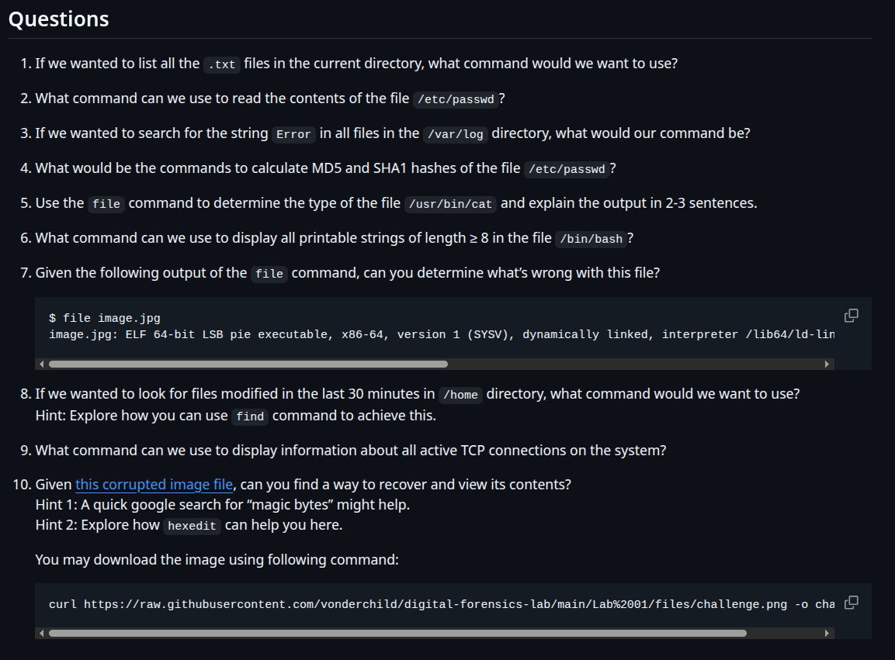

## Introduction

Avant de parler de mémoire vive, de captures réseau ou de malwares, toute investigation commence par des gestes simples : trouver un fichier, le lire, vérifier qu'il n'a pas été modifié, comprendre ce qu'il est vraiment. Sur un poste d'analyse Linux, ces gestes passent par une poignée de commandes qu'on finit par taper sans y penser.

Ce premier lab sert précisément à installer ces réflexes. Les neuf premières questions passent en revue les commandes de base (recherche, lecture, hachage, identification de type, connexions réseau). La dixième est un vrai petit défi : une image PNG volontairement corrompue, qu'il faut diagnostiquer puis réparer à la main, octet par octet.

## Rappels : les notions du lab

**L'extension ne dit pas la vérité.** Sous Linux, un fichier nommé `photo.jpg` peut contenir n'importe quoi. Ce qui définit réellement un fichier, c'est son contenu, et en particulier ses tout premiers octets.

**Les magic bytes.** La plupart des formats commencent par une signature fixe, appelée *magic bytes* (ou nombre magique). C'est elle que lit la commande `file` pour reconnaître un format. Quelques signatures à connaître :

| Format | Signature (hexadécimal) | Lisible en ASCII |
|---|---|:---:|
| PNG | `89 50 4E 47 0D 0A 1A 0A` | `.PNG....` |
| JPEG | `FF D8 FF` | aucun |
| PDF | `25 50 44 46` | `%PDF` |
| ZIP (et donc DOCX, PPTX, XLSX) | `50 4B 03 04` | `PK..` |
| Exécutable Linux (ELF) | `7F 45 4C 46` | `.ELF` |

Si cette signature est abîmée, `file` ne reconnaît plus rien et les logiciels refusent d'ouvrir le fichier, alors même que tout le reste du contenu est intact.

**Le hachage.** Une fonction de hachage (MD5, SHA1, SHA256) produit une empreinte de taille fixe à partir d'un fichier. Le moindre octet modifié change complètement l'empreinte. En forensique, on hache une preuve dès qu'on la récupère : c'est ce qui permet de démontrer plus tard qu'elle n'a pas bougé. À noter : MD5 et SHA1 sont aujourd'hui considérés comme faibles face aux collisions, on leur préfère SHA256 pour un usage sérieux.

## La boîte à outils

| Commande | Ce qu'elle fait |
|---|---|
| `ls`, `find` | Lister et rechercher des fichiers (par nom, date, taille…) |
| `cat` | Afficher le contenu d'un fichier |
| `grep` | Chercher une chaîne de caractères dans un ou plusieurs fichiers |
| `md5sum`, `sha1sum` | Calculer l'empreinte d'un fichier |
| `file` | Identifier le vrai type d'un fichier grâce à ses magic bytes |
| `strings` | Extraire le texte lisible d'un fichier binaire |
| `ss`, `netstat` | Afficher les connexions réseau actives |
| `exiftool` | Lire les métadonnées d'un fichier |
| `hexedit` | Afficher et modifier un fichier octet par octet |

## Le fil du lab, en une phrase

On révise une à une les commandes de base de l'analyste, puis on les met toutes au service d'un cas concret : une image qui refuse de s'ouvrir, dont on retrouve et répare la signature pour en extraire le flag.

---

## Résolution, question par question

### Question 1 : lister les fichiers `.txt` du répertoire courant

Pour tester proprement, je crée un petit dossier de travail avec quelques fichiers factices :

```bash
mkdir test-Lab_01 && cd test-Lab_01
touch a.txt b.txt c.txt
ls *.txt
find . -name "*.txt"
```

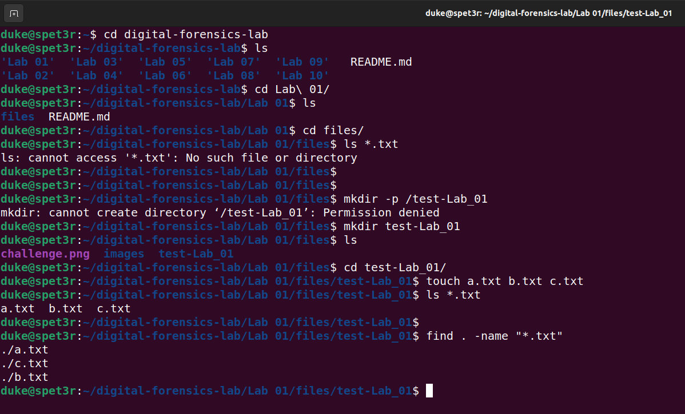

`ls *.txt` suffit pour le répertoire courant : le shell remplace `*.txt` par tous les noms qui se terminent ainsi. `find . -name "*.txt"` va plus loin et descend aussi dans les sous dossiers.

> Réflexe : `ls` pour regarder ici, `find` dès qu'il faut fouiller toute une arborescence.

### Question 2 : lire le contenu de `/etc/passwd`

```bash
cat /etc/passwd
```

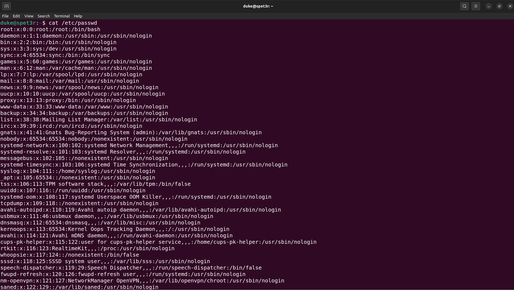

`cat` affiche tout le fichier. Chaque ligne décrit un compte du système : nom, identifiant (UID), groupe (GID), dossier personnel et shell par défaut. Malgré son nom, ce fichier ne contient plus de mots de passe depuis longtemps : ils sont rangés, hachés, dans `/etc/shadow`, lisible uniquement par root.

> Réflexe : `/etc/passwd` est l'un des premiers fichiers qu'un attaquant cherche à lire, et l'un des premiers qu'un analyste regarde pour repérer un compte suspect.

### Question 3 : chercher la chaîne `Error` dans `/var/log`

```bash
sudo grep -r "Error" /var/log/
```

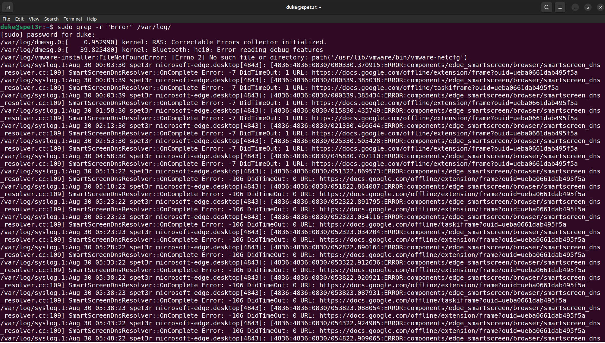

L'option `-r` rend la recherche récursive : `grep` parcourt tous les fichiers du dossier et de ses sous dossiers. Le `sudo` est nécessaire, car une partie des journaux de `/var/log` n'est lisible que par root. Sans lui, on obtient une pluie de `Permission denied` et des résultats incomplets.

> Réflexe : `grep -r` sur `/var/log` est souvent la toute première recherche lors d'un incident sur une machine Linux. On peut y ajouter `-i` pour ignorer la casse (`Error`, `error`, `ERROR`).

### Question 4 : calculer les empreintes MD5 et SHA1 de `/etc/passwd`

```bash
md5sum /etc/passwd
sha1sum /etc/passwd
```

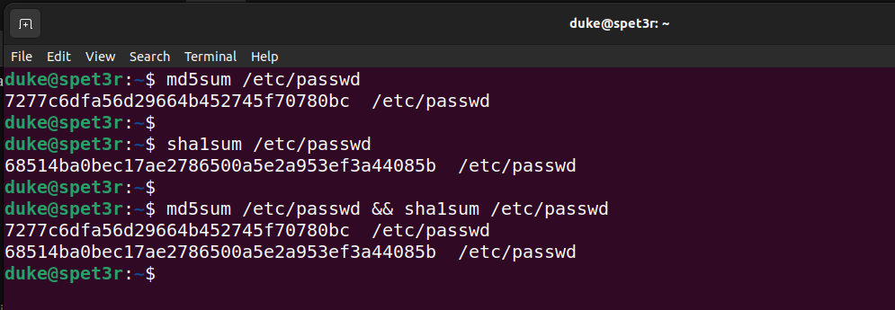

Une commande par algorithme. Ces empreintes servent de référence : si je recalcule plus tard la même empreinte et qu'elle a changé, c'est que le fichier a été modifié.

> Réflexe : hacher une preuve au moment où on la collecte, et noter l'empreinte. C'est la base de la chaîne de traçabilité.

### Question 5 : le type du fichier `/usr/bin/cat`, expliqué

```bash
file /usr/bin/cat
```

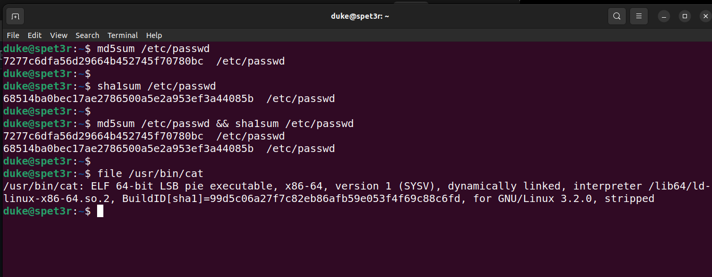

Sortie obtenue :

```
/usr/bin/cat: ELF 64-bit LSB pie executable, x86-64, version 1 (SYSV), dynamically linked, interpreter /lib64/ld-linux-x86-64.so.2, BuildID[sha1]=99d5c06a27f7c82eb86afb59e053f4f69c88c6fd, for GNU/Linux 3.2.0, stripped
```

En clair : `/usr/bin/cat` est un exécutable au format **ELF**, le format binaire standard sous Linux, compilé pour une architecture **64 bits**. Il est **dynamiquement lié** : au lieu d'embarquer tout son code, il s'appuie sur des bibliothèques partagées chargées au lancement, d'où la présence d'un interpréteur (`/lib64/ld-linux-x86-64.so.2`) chargé de les trouver. Enfin, `stripped` signifie que les symboles de débogage ont été retirés du binaire.

### Question 6 : les chaînes imprimables d'au moins 8 caractères dans `/bin/bash`

```bash
strings -8 /bin/bash
```

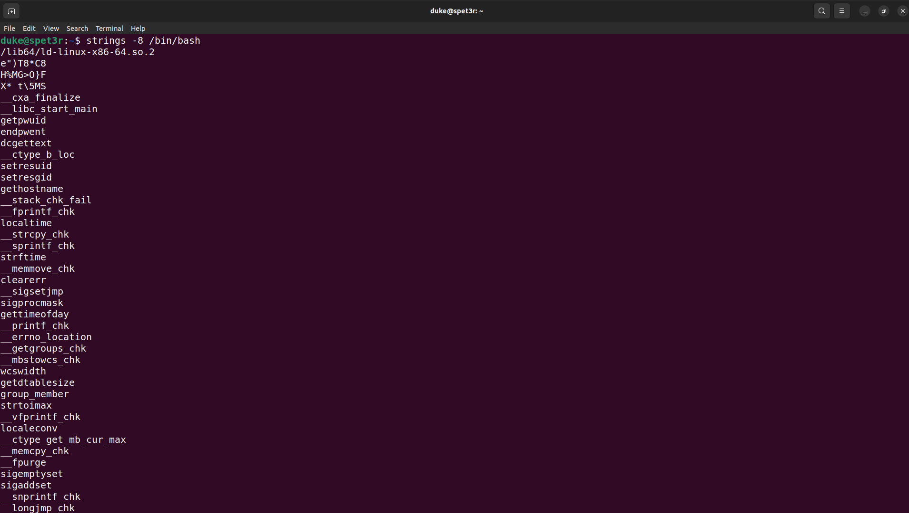

Un binaire contient surtout des octets illisibles, mais aussi des morceaux de texte : messages d'erreur, noms de fonctions, chemins. `strings` les extrait. L'option `-8` (équivalente à `-n 8`) ne garde que les chaînes d'au moins 8 caractères, ce qui élimine beaucoup de bruit.

> Réflexe : face à un binaire inconnu, `strings` est souvent le premier coup d'œil. Une URL, une adresse IP ou un nom de fichier qui en sort est déjà une piste.

### Question 7 : ce qui cloche dans une sortie de `file`

L'énoncé fournit cette sortie :

```
$ file image.jpg
image.jpg: ELF 64-bit LSB pie executable, x86-64, version 1 (SYSV), dynamically linked, interpreter /lib64/ld-lin[...]
```

Le fichier porte l'extension `.jpg`, il devrait donc être une image. Mais `file`, qui lit le contenu et non le nom, le reconnaît comme un **exécutable Linux ELF**. L'extension a été changée pour faire passer un programme pour une image inoffensive. C'est une technique classique pour tromper un utilisateur, ou pour contourner un contrôle qui ne vérifie que l'extension (un formulaire d'envoi qui n'accepte « que des images », par exemple).

> Réflexe : ne jamais se fier à l'extension. `file` d'abord, toujours.

### Question 8 : les fichiers modifiés dans les 30 dernières minutes sous `/home`

```bash
find /home/ -mmin -30
```

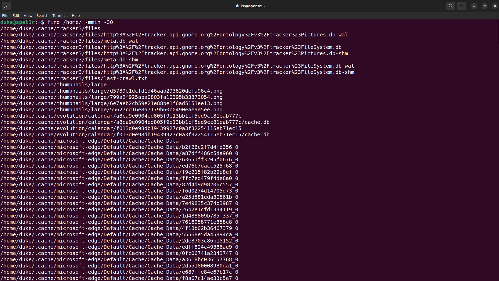

L'option `-mmin -30` sélectionne les fichiers dont le contenu a été modifié il y a **moins de** 30 minutes. Le signe compte : `-30` veut dire « moins de 30 », `+30` voudrait dire « plus de 30 ».

> Réflexe : lors d'un incident, filtrer par date de modification permet de retrouver très vite ce qu'un attaquant vient de créer ou de toucher.

### Question 9 : les connexions TCP actives

```bash
ss -tn
netstat -tn
```

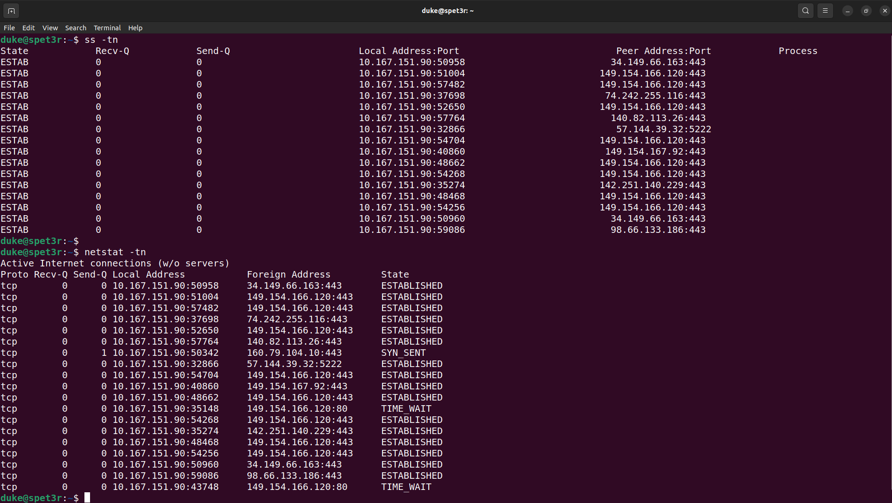

`ss` est l'outil moderne, `netstat` son ancêtre, toujours très répandu. Dans les deux cas, `-t` limite l'affichage au TCP et `-n` affiche les adresses et ports en chiffres, sans tenter de résolution DNS (plus rapide, et plus fiable pendant une analyse).

> Réflexe : une connexion établie vers une adresse inconnue, sur un port inhabituel, mérite toujours qu'on s'y arrête.

### Question 10 : récupérer le contenu de l'image corrompue

C'est le vrai défi du lab. On reçoit `challenge.png`, qui refuse de s'ouvrir.

#### Étape 1 : constater la corruption

```bash
file challenge.png
exiftool challenge.png
```

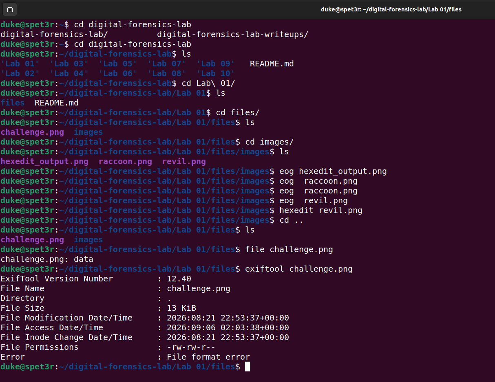

`file` répond simplement `data` : il ne reconnaît aucun format. `exiftool` confirme avec `File format error`. Le nom dit PNG, le contenu ne ressemble à rien de connu. Vu les rappels du début, le premier suspect est tout trouvé : la signature.

#### Étape 2 : regarder les octets bruts

```bash
hexedit challenge.png
```

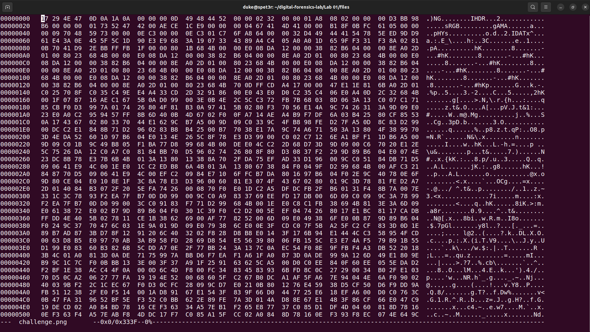

Les huit premiers octets valent `17 29 4E 47 0D 0A 1A 0A`. La signature PNG attendue est `89 50 4E 47 0D 0A 1A 0A`. Seuls les deux premiers octets sont faux (`17 29` au lieu de `89 50`). Le reste, `4E 47` (les lettres « NG ») suivi des octets de contrôle `0D 0A 1A 0A`, est intact.

#### Étape 3 : corriger la signature

Dans `hexedit`, je remplace les deux octets fautifs :

```
17 → 89
29 → 50
```

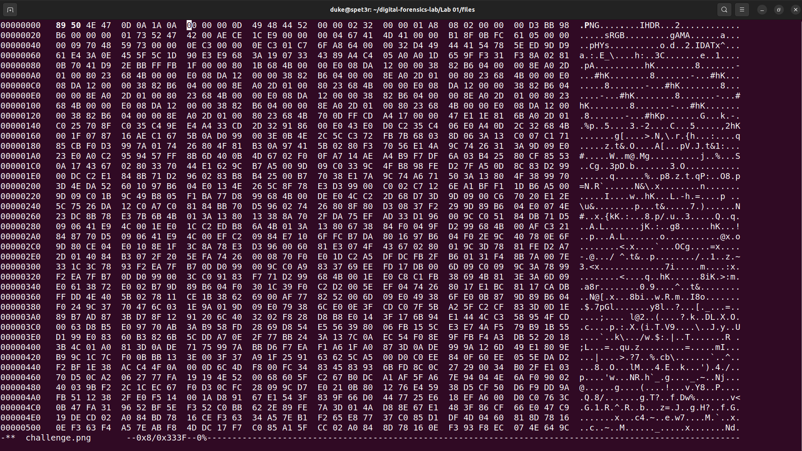

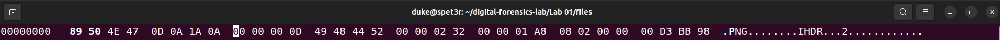

Puis j'enregistre avec `Ctrl+X`.

#### Étape 4 : vérifier la réparation

```bash
file challenge.png
exiftool challenge.png
```

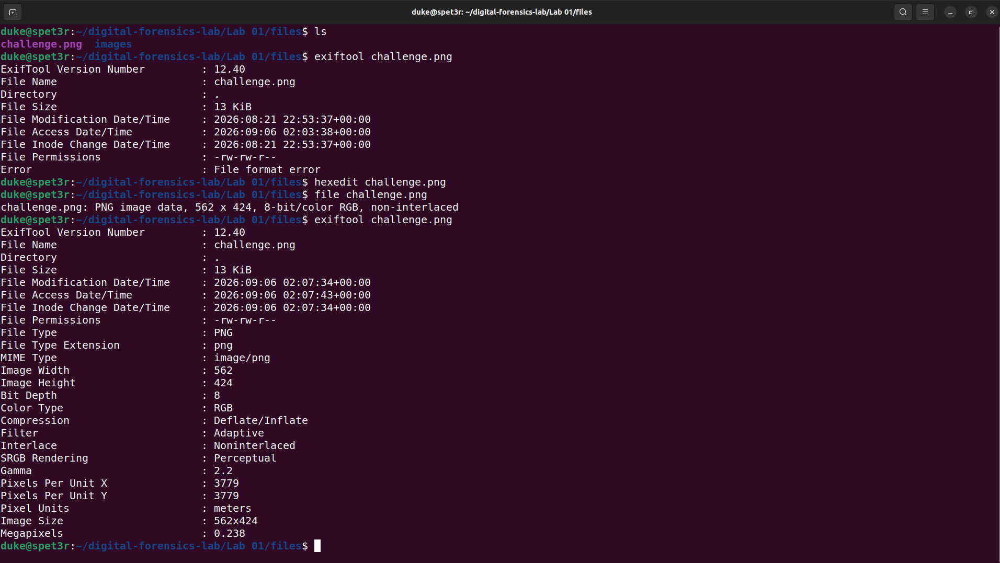

Cette fois, `file` reconnaît une `PNG image data, 562 x 424, 8-bit/color RGB, non-interlaced`, et `exiftool` affiche toutes les métadonnées sans erreur. Deux octets suffisaient.

#### Étape 5 : ouvrir l'image

```bash
eog challenge.png
```

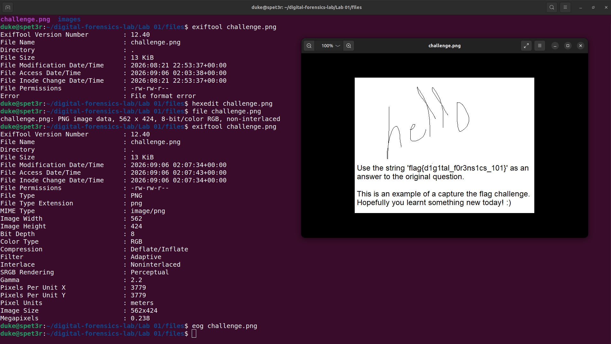

L'image s'ouvre sur un « hello world » manuscrit, accompagné de ce texte :

> *Use the string 'flag{d1g1tal_f0r3ns1cs_101}' as an answer to the original question. This is an example of a capture the flag challenge. Hopefully you learnt something new today! :)*

```
flag{d1g1tal_f0r3ns1cs_101}
```

> Réflexe : quand un fichier refuse de s'ouvrir, comparer ses premiers octets à la signature attendue de son format. C'est souvent là que tout se joue.

---

## Récapitulatif

| # | Question | Réponse |
|:---:|---|---|
| 1 | Lister les `.txt` | `ls *.txt` (ou `find . -name "*.txt"` pour les sous dossiers) |
| 2 | Lire `/etc/passwd` | `cat /etc/passwd` |
| 3 | Chercher `Error` dans `/var/log` | `sudo grep -r "Error" /var/log/` |
| 4 | Empreintes MD5 et SHA1 | `md5sum /etc/passwd` et `sha1sum /etc/passwd` |
| 5 | Type de `/usr/bin/cat` | Exécutable ELF 64 bits, dynamiquement lié, sans symboles (`stripped`) |
| 6 | Chaînes de 8 caractères ou plus | `strings -8 /bin/bash` |
| 7 | Ce qui cloche avec `image.jpg` | C'est un exécutable ELF déguisé en image |
| 8 | Fichiers modifiés depuis 30 min | `find /home/ -mmin -30` |
| 9 | Connexions TCP actives | `ss -tn` (ou `netstat -tn`) |
| 10 | Image corrompue | Signature `17 29` corrigée en `89 50` → `flag{d1g1tal_f0r3ns1cs_101}` |

### Ce que j'ai appris

* Un fichier se définit par son **contenu**, pas par son nom : `file` lit les magic bytes, et c'est lui qu'il faut croire.
* Connaître les **signatures** des formats courants permet de diagnostiquer une corruption en quelques secondes.
* Une réparation forensique peut être **chirurgicale** : ici, deux octets modifiés suffisaient à rendre un fichier entier illisible.
* Le **hachage** est le premier geste face à une preuve : il garantit qu'on pourra prouver plus tard qu'elle n'a pas changé.
* `grep`, `find` et `strings` sont les trois commandes qui font gagner le plus de temps quand on ne sait pas encore quoi chercher.

## Note

Les commandes ont été exécutées sur un poste d'analyse Ubuntu. Le fichier `challenge.png` provient du dépôt du lab et n'est pas redistribué ici ; seules les captures d'analyse accompagnent ce write-up.

## Source

Lab issu de [vonderchild/digital-forensics-lab, Lab 01](https://github.com/vonderchild/digital-forensics-lab/tree/main/Lab%2001).
