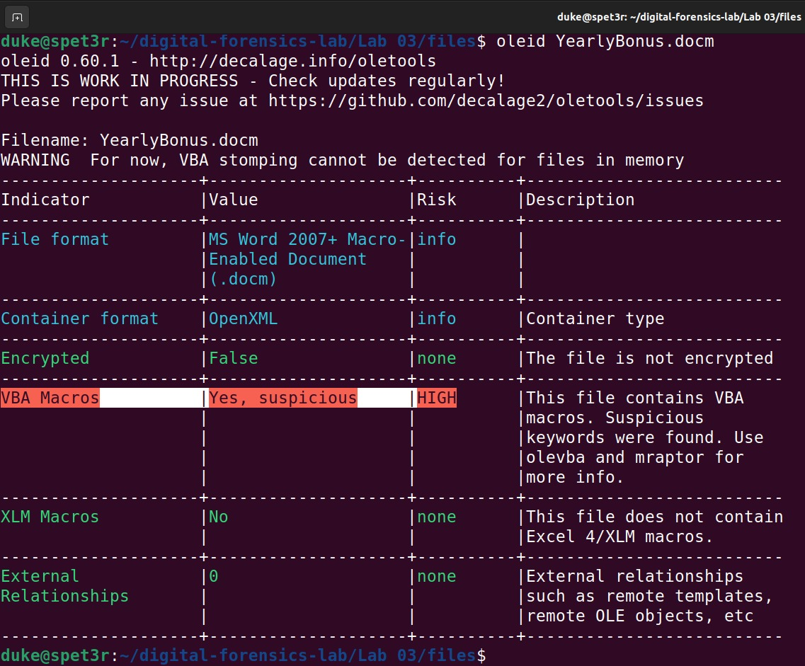
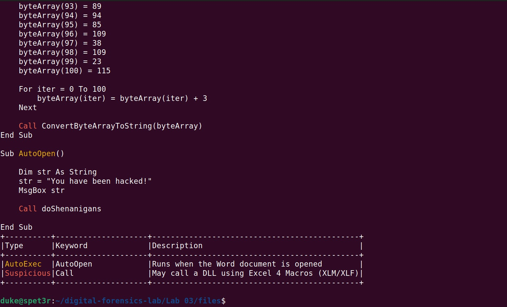
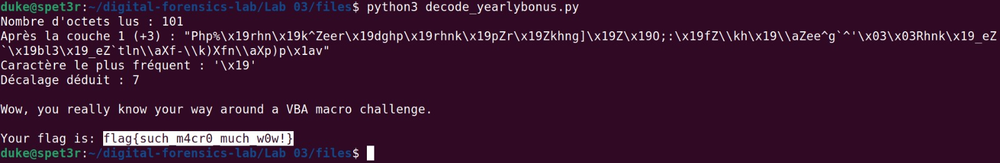
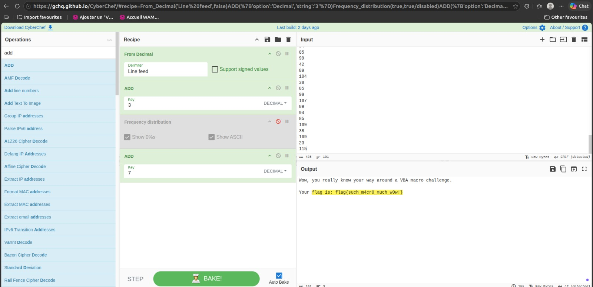
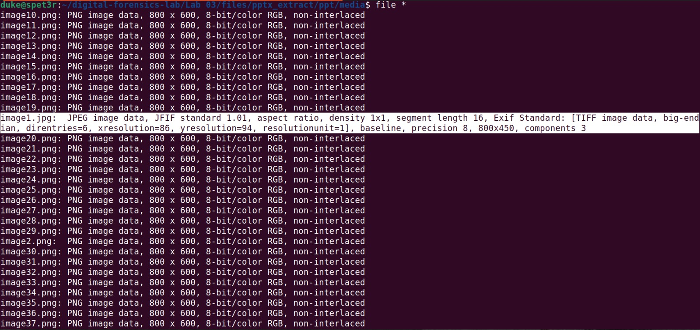
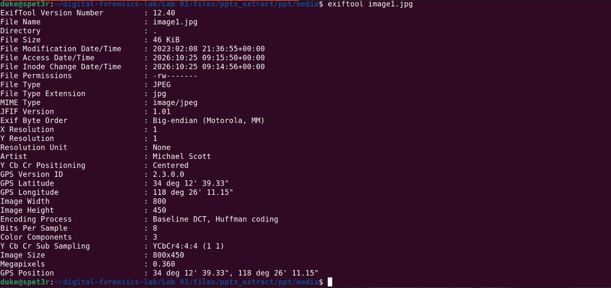
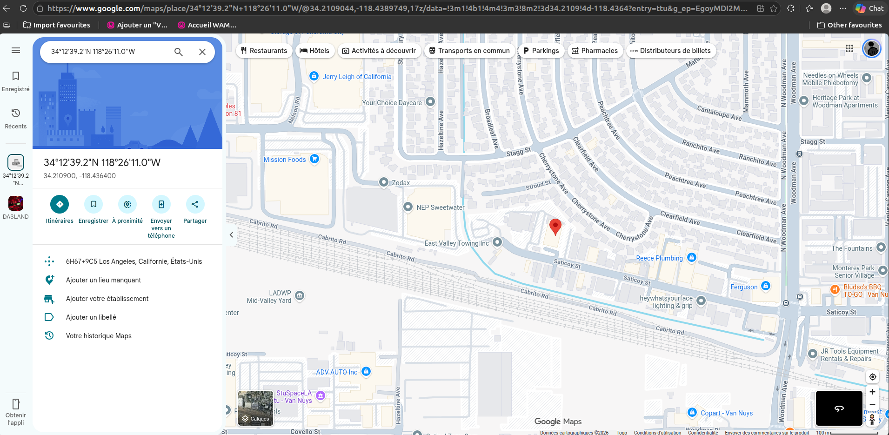
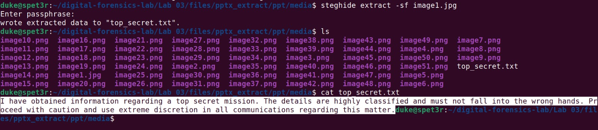
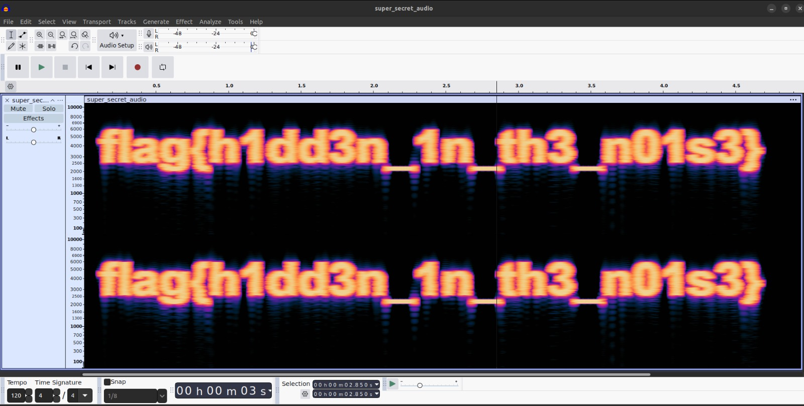

# Lab 03 — Analyse de documents & Stéganographie

> Write-up de la série sur le dépôt [vonderchild/digital-forensics-lab](https://github.com/vonderchild/digital-forensics-lab).
> Chaque exercice est traité comme une investigation : démarche, outils et raisonnement pas seulement la réponse.

Ce lab couvre les documents piégés et la stéganographie sous trois formes : une **macro VBA malveillante**, une **image dissimulée dans un PowerPoint** (métadonnées + payload caché), et un **message caché dans un fichier audio**.

## Environnement & outils

| Étape | Outils |
|---|---|
| Système d'analyse | Ubuntu poste d'analyse Linux, isolé des fichiers bruts |
| Document & macro | `oletools` (`oleid`, `olevba`), Python 3, CyberChef |
| Image & métadonnées | `file`, `unzip`, `exiftool`, `steghide` |
| Audio | Audacity (vue spectrogramme) |

> ⚠️ **Manipulation responsable.** Le `.docm` contient une macro active et les images un payload stéganographié. Toute l'analyse est **statique** les fichiers ne sont **jamais exécutés ni ouverts** dans une suite bureautique et se fait sur des copies. Les fichiers bruts ne sont pas redistribués dans ce dépôt.

---

## Exercice 1 — Macro VBA malveillante (`YearlyBonus.docm`)

**Scénario.** Un employé a ouvert un document Word piégé reçu par phishing. Un secret révélant l'identité de l'attaquant est dissimulé dans le code de la macro. Format attendu : `flag{...}`.

### 1. Triage initial

```bash
file YearlyBonus.docm        # Microsoft Word 2007+
oleid YearlyBonus.docm       # détection rapide d'indicateurs de risque
```

`oleid` classe d'emblée le fichier comme **risque élevé** : macros VBA présentes et mots-clés suspects.



### 2. Extraction de la macro sans jamais l'exécuter

```bash
olevba YearlyBonus.docm
```

`olevba` lit le code VBA à froid (analyse statique). Le code révèle la logique de dissimulation :

- `AutoOpen()` s'exécute à l'ouverture du document et affiche « You have been hacked! », puis appelle `doShenanigans`.
- `doShenanigans()` construit un tableau de **101 octets**, puis **ajoute 3 à chaque octet** avant de le convertir en texte.



Le texte obtenu après ce `+3` reste **illisible** : il existe une **seconde couche** d'encodage, absente du code, qu'il faut retrouver.

### 3. Décodage — Méthode A : réécriture en Python (analyse statique)

Plutôt que d'exécuter la macro, j'en **réécris la logique** en Python, ce qui est sûr, reproductible et vérifiable. J'extrais d'abord les 101 octets du code en une commande :

```bash
olevba YearlyBonus.docm | grep -oP 'byteArray\(\d+\) = \K\d+' > bytes.txt
```

Le script applique la couche 1 (`+3`, comme la macro), puis **déduit la couche 2 par analyse de fréquence** : dans une phrase anglaise le caractère le plus fréquent est l'espace (ASCII 32). Le caractère le plus fréquent après `+3` étant `\x19` (ASCII 25), le décalage manquant vaut `32 − 25 = 7`. Décalage total : **+10**.

```python
from collections import Counter

b = [int(x) for x in open('bytes.txt').read().split()]   # les 101 octets
s = ''.join(chr(v + 3) for v in b)                        # couche 1 : +3 (la macro)
decalage = 32 - ord(Counter(s).most_common(1)[0][0])      # couche 2 déduite : 7
message = ''.join(chr(ord(c) + decalage) for c in s)      # couche 2 appliquée
print(message)
```

> Le script complet et commenté est fourni : [`decode_yearlybonus.py`](./decode_yearlybonus.py).



### 4. Décodage — Méthode B : CyberChef (vérification visuelle)

La même attaque, sans code, pour confirmer : `From Decimal` → `ADD 3` → `ADD 7`. L'opération **Frequency distribution** sert à *voir* le décalage : le pic de fréquence confirme le caractère dominant et donc le `+7` à appliquer.



### Résultat

```
flag{such_m4cr0_much_w0w!}
```

### Ce que j'ai appris
- Un `.docm` / `.pptm` / `.xlsm` est un document **à macros** : `oleid` pour le triage, `olevba` pour lire le VBA **sans l'exécuter**.
- L'obfuscation peut être **multi-couches** : une partie visible dans le code (`+3`), une partie cachée (`+7`) retrouvée par **analyse de fréquence** la même technique que le cassage d'un chiffre de César.
- Réécrire la logique d'un malware en Python est plus sûr et plus pédagogique que de l'exécuter.

---

## Exercice 2 — Image dissimulée dans un PowerPoint (`Presentation.pptx`)

**Scénario.** Une taupe a transmis à un espion une image contenant une information top secrète, cachée dans un PowerPoint sous de nombreuses images-leurres. Mission : extraire la **première image**, l'**information top secrète**, ainsi que le **nom et la localisation** de la source.

### 1. Un `.pptx` est une archive ZIP

Le format OOXML stocke tout dans un conteneur ZIP. On l'extrait donc sans PowerPoint :

```bash
mkdir pptx_extract && cd pptx_extract
unzip ../Presentation.pptx
ls ppt/media/            # 51 images : image1 … image51
```

### 2. Repérer l'intrus par son format

```bash
file ppt/media/image*
```

Toutes les images-leurres sont des **PNG 800×600**… sauf une : `image1.jpg`, le seul **JPEG** (800×450). C'est la porteuse.



### 3. Métadonnées → nom + localisation de la source

Premier réflexe sur toute image : `exiftool`.

```bash
exiftool image1.jpg
```

- **Artist : `Michael Scott`** → le nom de la source.
- **GPS : `34°12'39.33"N 118°26'11.15"W`** → sa localisation.



Conversion en degrés décimaux et géolocalisation (`34.2109, -118.4364`, **Nord/Ouest** → États-Unis) : la source se situe à **Van Nuys, Los Angeles, Californie**.



### 4. Le payload caché → steghide (car JPEG)

Le format choisit l'outil : pour un **JPEG**, c'est `steghide` (et non `zsteg`, réservé au PNG/BMP).

```bash
steghide extract -sf image1.jpg      # passphrase vide
cat top_secret.txt
```



### Résultat
- **Information top secrète** : *« I have obtained information regarding a top secret mission… »* (`top_secret.txt`).
- **Source** : Michael Scott Van Nuys, Los Angeles (34.2109, −118.4364).

### Ce que j'ai appris
- Les documents Office = archives ZIP : on explore `ppt/media/` (ou `word/media/`) sans ouvrir le fichier.
- **Repérer l'anomalie** : au milieu de 50 fichiers identiques, celui qui diffère par son format est le bon.
- Deux canaux de dissimulation distincts : les **métadonnées** (`exiftool` → nom + GPS) et le **payload stéganographié** (`steghide`).
- **Réserve forensique** : une métadonnée EXIF se falsifie en quelques secondes c'est une **piste**, pas une preuve.

---

## Exercice 3 — Stéganographie audio (`super_secret_audio.wav`)

**Scénario.** Un flag est dissimulé dans un fichier audio ; il faut le récupérer via le spectrogramme et fournir une capture.

### Démarche

```bash
file super_secret_audio.wav          # WAVE, PCM 16 bits, stéréo, 22050 Hz
audacity super_secret_audio.wav
```

Dans Audacity : menu de la piste → **Spectrogramme** (au lieu de *Forme d'onde*). Le message n'est pas dans les octets, il est **dessiné dans les fréquences**. La forme d'onde montrait d'ailleurs des salves régulières, signature typique d'un texte spectral.

### Résultat

```
flag{h1dd3n_1n_th3_n01s3}
```



### Ce que j'ai appris
- Certains messages ne se **lisent** pas, ils se **voient** : le spectrogramme (Audacity / Sonic Visualiser) est le réflexe pour la stéganographie audio.
- La vue *forme d'onde* peut déjà trahir la présence d'un message (salves régulières le long du temps).

---

## Récapitulatif des techniques

| Exercice | Vecteur | Outils clés | Concept |
|---|---|---|---|
| 1 | Macro VBA (`.docm`) | `oleid`, `olevba`, Python, CyberChef | Analyse statique + désobfuscation multi-couches (analyse de fréquence) |
| 2 | Image dans un `.pptx` | `unzip`, `file`, `exiftool`, `steghide` | OOXML = ZIP · anomalie de format · métadonnées + OSINT GPS · stégano JPEG |
| 3 | Audio (`.wav`) | Audacity | Stéganographie spectrale |

## Note éthique

Les artefacts bruts du lab (document à macro, images porteuses, audio) ne sont **pas redistribués** dans ce dépôt ; seules les captures d'analyse le sont. L'analyse a été menée en **statique**, sans exécution des fichiers piégés.

## Source

Lab issu de [vonderchild/digital-forensics-lab — Lab 03](https://github.com/vonderchild/digital-forensics-lab/tree/main/Lab%2003).
